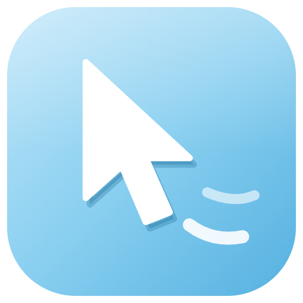
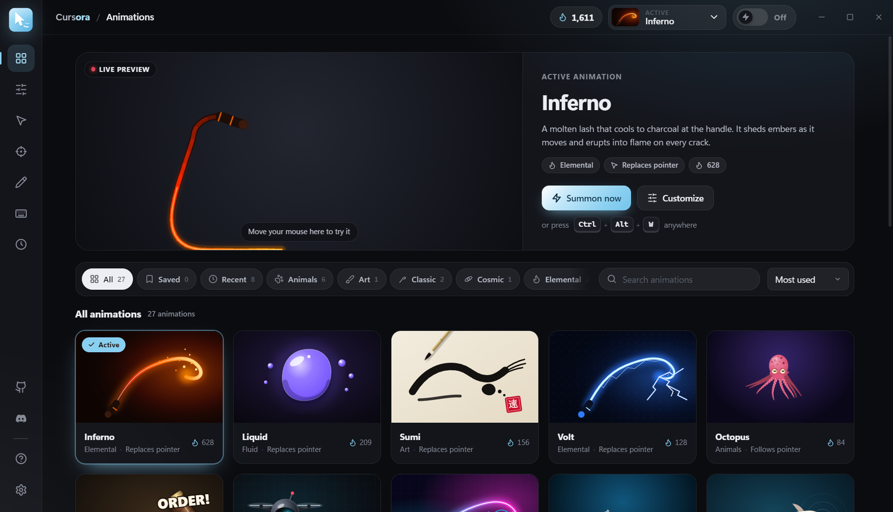
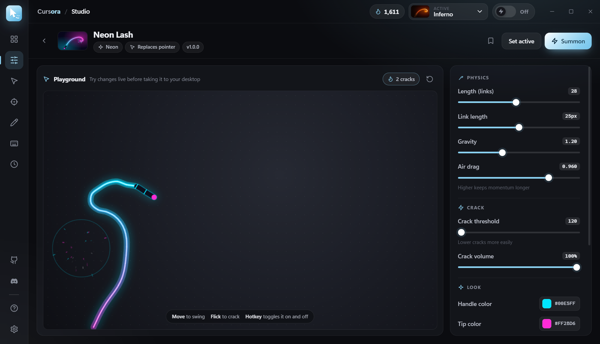
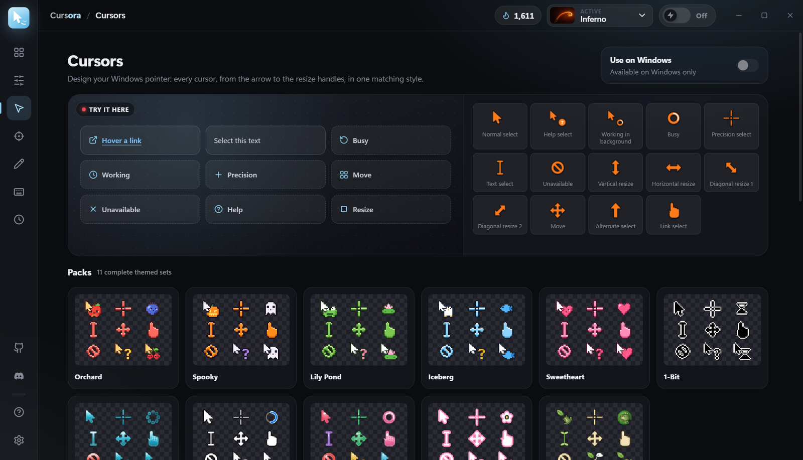
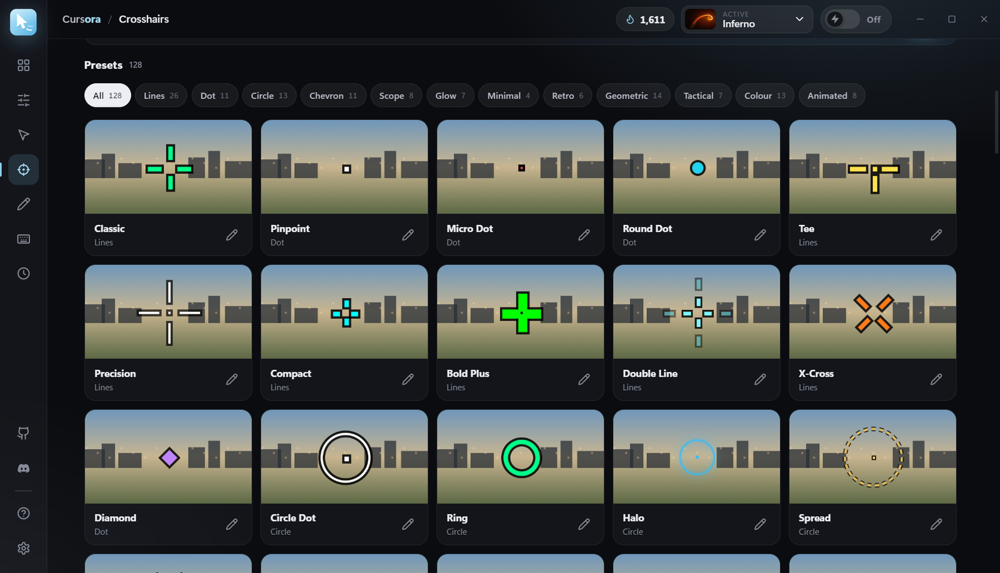
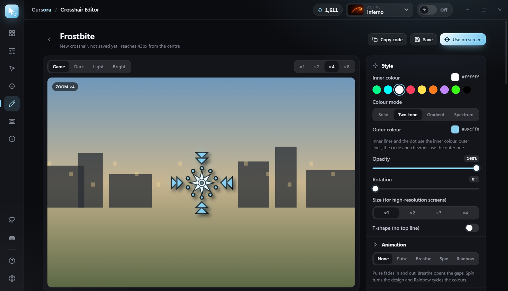
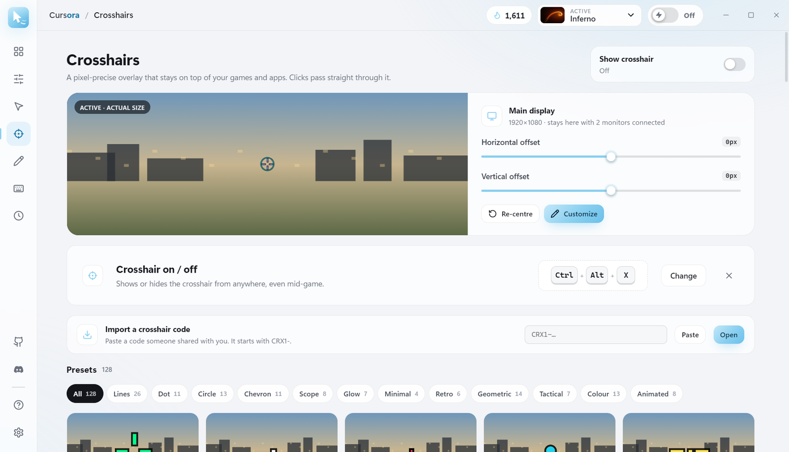

<p align="center">
  
</p>

<h1 align="center">Cursora</h1>

<p align="center">
  <b>Your cursor, reimagined.</b><br>
  Animations that follow your pointer, custom Windows cursors and pixel-perfect crosshairs, in one lightweight tray app.
</p>

<p align="center">
  <a href="https://github.com/xb48/Cursora/releases/latest"></a>
  <a href="https://github.com/xb48/Cursora/releases"></a>
  
  <a href="https://discord.gg/qat8yUcYqh"></a>
  
</p>

<p align="center">
  <a href="https://github.com/xb48/Cursora/releases/latest"><b>Download for Windows</b></a>
  &nbsp;·&nbsp;
  <a href="#features">Features</a>
  &nbsp;·&nbsp;
  <a href="#build-from-source">Build from source</a>
  &nbsp;·&nbsp;
  <a href="https://discord.gg/qat8yUcYqh">Support</a>
</p>

<p align="center">
  
</p>

## Features

### Animations that follow every move

27 hand-crafted animations, each with its own trigger, sound and effect.

- **Whips**: The Whip, Heritage, Neon Lash, Aurora, Volt and Inferno. Flick the mouse to crack them.
- **Props**: The Gavel, Overdrive, Sentinel, Liquid, Afterburner, Singularity, Tesseract, Koi, Stormcloud, Deadline, Sumi, Prism, Gyroscope and Paper Plane.
- **Companions**: a cat, a corgi, a shark, an octopus, a bee swarm, a jellyfish and a realistic 3D frog that hops after your pointer.

Summon an animation with `Ctrl+Alt+W` or the tray icon. Clicks pass straight through to your apps, so you can keep working.

### Studio

A live playground for every animation, with its own physics, look and sound settings. Try changes before taking them to your desktop.

<p align="center"></p>

### Custom Windows cursors

Restyle all 14 Windows cursors at once:

- **11 themed packs**, including animated ones such as Meadow Frog and Orchard;
- **24 designer presets**;
- **your own design**, from 12 shapes, 6 finishes (solid, bold, glass, neon, gloss and jelly), any colour, 9 patterns or 38 national flags.

Windows gets its own cursors back when you quit.

<p align="center"></p>

### Crosshairs

A pixel-precise crosshair overlay that stays on top of windowed and borderless-fullscreen games. Clicks pass straight through it.

- **128 presets**, in 12 categories: lines, dots, circles, chevrons, scopes, tactical, glow, minimal, retro, geometric, colour and animated.
- **Always on your main display**, with offsets to fine-tune its position.
- **Its own hotkey**, `Ctrl+Alt+X`.

<p align="center"></p>

### Crosshair Editor

Build a crosshair from scratch:

- **Colour:** solid, two-tone, gradient or spectrum colour modes.
- **Animation:** pulse, breathe, spin or rainbow.
- **Effects:** outline, glow and drop shadow.
- **Shape:** six line layouts with square, round or tapered ends, nine circle styles, six centre-dot shapes, and chevrons on up to four sides.

Preview it at actual size or zoomed up to ×8, save up to 100 crosshairs, and share them as `CRX1-` codes.

<p align="center"></p>

### And more

- **Lives in the tray**, launches at sign-in if you want, and stays out of your way.
- **Dark and light themes** that follow Windows.
- **Global hotkeys** for the animation and the crosshair.
- **Automatic updates** that install silently and show what's new.

<p align="center"></p>

## Download

Get the latest **`Cursora-Setup-<version>.exe`** from [Releases](https://github.com/xb48/Cursora/releases/latest) and run it.

- It installs for your user account only, so there's no admin prompt.
- It adds Start menu and desktop shortcuts, and can be uninstalled from Settings → Apps.
- Prefer not to install? Use **`Cursora-Portable-<version>.exe`** instead. It runs as a single file.

Windows SmartScreen may warn about a new, unsigned app. Choose **More info → Run anyway**.

## Automatic updates

The installed app keeps itself up to date from this repository's Releases:

- About 15 seconds after it starts, and then every 6 hours, it checks for a newer version.
- It downloads updates in the background and checks each one against the release's SHA-512.
- It installs them silently the next time Cursora restarts or quits.
- A **Restart to update** button appears in the top bar and the tray menu when an update is ready.
- After updating, Cursora shows the release notes once.

You can turn automatic updates off in **Settings → Updates**. The portable app doesn't update itself.

## Build from source

You need [Node.js](https://nodejs.org) 18 or later. Cursora is developed and tested on Windows.

```bash
git clone https://github.com/xb48/Cursora.git
cd Cursora
npm install
npm start          # run the app
npm run dist       # build the installer and the portable app into dist/
```

| Command | What it does |
| --- | --- |
| `npm start` | Runs Cursora from source. |
| `npm run dist` | Builds `Cursora-Setup-<version>.exe`, `Cursora-Portable-<version>.exe` and `latest.yml` into `dist/`. |
| `npm run icon` | Regenerates every app icon from `icon/logo.svg`. |
| `npm run logo` | Regenerates the logo PNGs in `assets/brand/` from `icon/logo.svg`. |

### Publishing a release

Releases are built and published automatically by GitHub Actions ([`.github/workflows/release.yml`](.github/workflows/release.yml)):

1. Raise `version` in `package.json` (and `npm install` to update the lock file).
2. Write the notes for the new version in [`RELEASE_NOTES.md`](RELEASE_NOTES.md). They become the release description and the in-app What's New.
3. Commit, tag and push:

   ```bash
   git commit -am "Cursora 2.18.1"
   git tag v2.18.1
   git push origin main v2.18.1
   ```

The workflow checks that the tag matches `package.json` and builds the installer, the portable app, the blockmap and `latest.yml` on Windows. It uploads them to a draft release, confirms every file arrived, then publishes the release. Installed copies find it, download it in the background and install it on their next restart.

## Project structure

```
main.js            app process: windows, tray, hotkeys, overlays, cursors, updates
preload.js         bridge for the animation overlays
app/               the app window (pages, styles, icons), cursor and crosshair engines
animations/        one folder per animation (see animations/README.md)
icon/              vector logo and the generated app icons
assets/            brand logos, social preview and README screenshots
scripts/           build, icon and logo scripts
```

Want to add an animation? Read [animations/README.md](animations/README.md).

## Support

Found a bug or have an idea? Join the [Discord server](https://discord.gg/qat8yUcYqh) and open a support ticket.

## Credits

[Cursora](https://github.com/xb48/Cursora) by [Xb48](https://github.com/xb48).

## License

MIT, as declared in [`package.json`](package.json).
